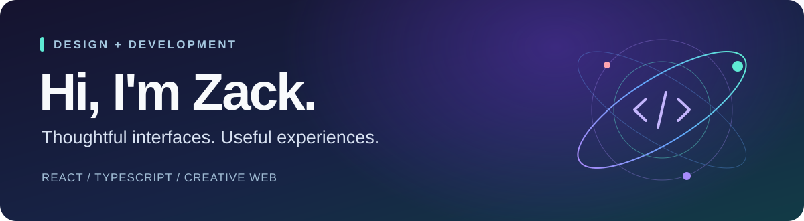

  

  Building <b>Tally</b>, my main finance app, and creating thoughtful digital experiences.

  <a href="https://github.com/zack005-design/Tally"><b>Explore Tally ↗</b></a>
  &nbsp; · &nbsp;
  <a href="https://github.com/zack005-design?tab=repositories">Browse my projects</a>

## ✦ Main project

### [Tally](https://github.com/zack005-design/Tally)
**A finance app, currently in development.**

Tally is my main project and current development focus. I'm still building the app; the source code will be added to the repository as development progresses.

[**Follow the project ↗**](https://github.com/zack005-design/Tally)

## ◇ Also built

### [PixelNest](https://github.com/zack005-design/pixelnest)

A visual discovery app for browsing inspiration, collecting ideas into boards, and adding your own images. Built with React, TypeScript, Vite, and Framer Motion.

[Try the demo ↗](https://zack005-design.github.io/pixelnest/) &nbsp; · &nbsp; [View the code](https://github.com/zack005-design/pixelnest)

## ◈ Web toolkit

| Build | Design & interaction | Workflow |
| :--- | :--- | :--- |
| React · TypeScript | Responsive layouts | Git · GitHub |
| HTML · CSS | Framer Motion · Lucide | Vite |

## ↗ Current focus

Building Tally and refining the design and interactions of my projects.
